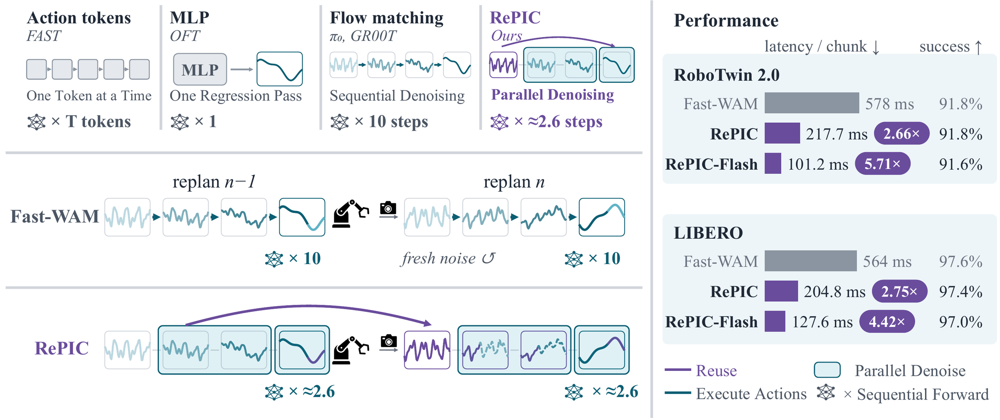
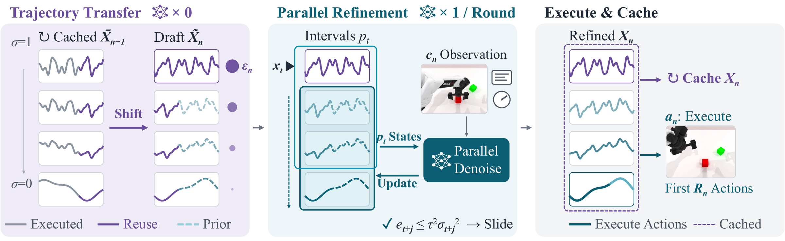
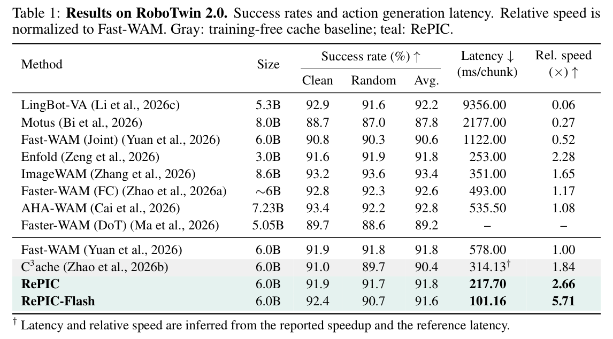
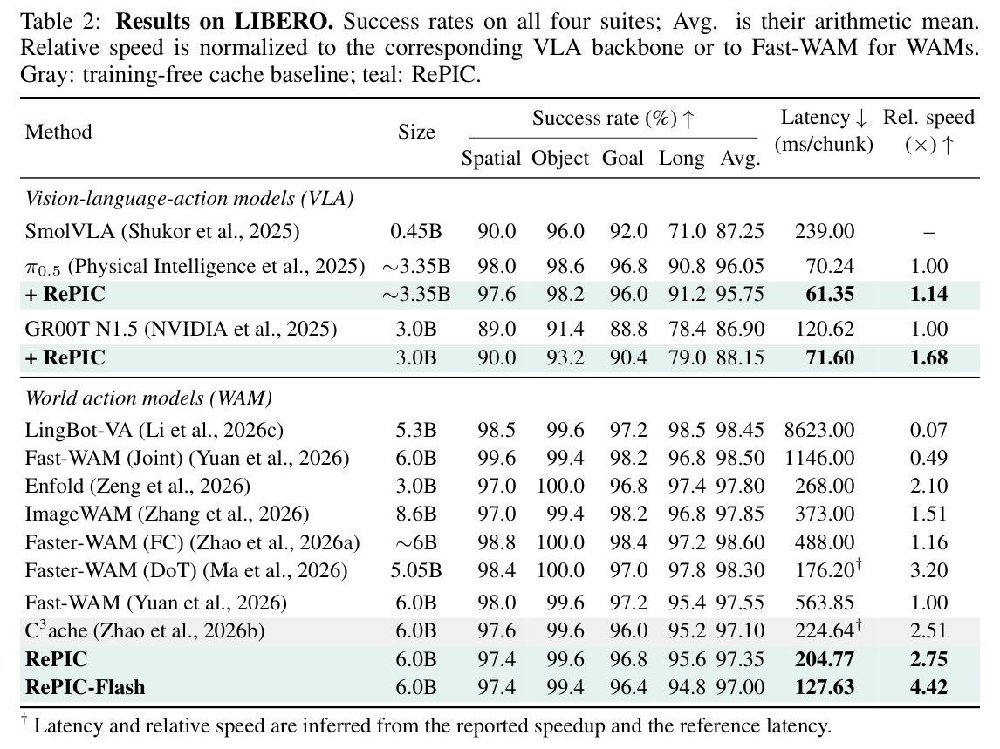
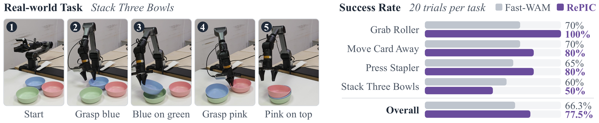

# Don't Throw Away the Solution: Training-Free Acceleration of Flow-Based Robot Policies

<div align="center">
  <a href="./README.md"></a>
  <a href="./README_zh.md"></a>
  <a href="https://github.com/H-EmbodVis/RePIC/blob/main/docs/static/pdfs/RePIC.pdf"></a>
  <a href="https://h-embodvis.github.io/RePIC/"></a>
  <a href="./LICENSE"></a>

  <h5 align="center"><em><a href="https://github.com/HyperbolicCurve">Xianjin Wu</a><sup>1,*</sup>, <a href="https://github.com/lixian-lipton">Xian Li</a><sup>1,*</sup>, Jianxiang Tang<sup>1</sup>, <a href="https://dk-liang.github.io/">Dingkang Liang</a><sup>1</sup>, <a href="https://scholar.google.com/citations?user=UeltiQ4AAAAJ&hl=en">Xiang Bai</a><sup>1</sup></em></h5>
  <sup>1</sup> 华中科技大学, <sup>*</sup> 共同第一作者
</div>

<div align="center">
  <a href="docs/static/images/intro.png">
    
  </a>
</div>

本仓库是上述论文 **RePIC**（别丢掉解：面向流匹配机器人策略的免训练加速）的官方实现。RePIC 是一种免训练的采样器：它复用上一次重规划（replan）丢弃的求解轨迹来初始化下一次求解，并通过批量不动点更新对其进行修正。`main` 分支基于 [Fast-WAM](https://github.com/yuantianyuan01/FastWAM)，另提供 π0.5（`pi` 分支）和 GR00T N1.5（`gr00t` 分支）的实现。

## 📄 摘要

流匹配机器人策略通过串行去噪生成每个动作块，并在每次重规划时丢弃求解轨迹，尽管相邻控制周期求解的是高度相关的问题。我们提出 **RePIC**，一种免训练采样器：它将缓存轨迹平移到新的时间窗，用闭式修正与新噪声对齐，再通过预训练网络的批量不动点更新对其修正，从而把精确的初始化转化为更少的串行网络调用。在 Fast-WAM 上，RePIC 在成功率相当的前提下，将 RoboTwin 2.0 和 LIBERO 上的动作生成延迟分别降低 **2.66×** 和 **2.75×**（RoboTwin 2.0 上配合 RePIC-Flash 达 **5.71×**）；无需重新训练即可将 π0.5 和 GR00T N1.5 分别加速 1.14× 和 1.68×；在真实机器人上成功率由 66.3% 提升至 77.5%。

## 🔍 方法

<div align="center">
  <a href="docs/static/images/pipeline.png">
    
  </a>
</div>

## 📣 新闻

- `2026.10`：发布论文，并开源 Fast-WAM（`main`）、π0.5（`pi`）和 GR00T N1.5（`gr00t`）三个分支的代码。

## 📈 性能

延迟为 NVIDIA RTX 4090（48 GB）上每个动作块的动作生成时间，不含观测获取、仿真步进和动作执行。下方的表格和图片均截取自论文。

<div align="center">
  <a href="docs/static/images/perf_robotwin.png">
    
  </a>
</div>

<div align="center">
  <a href="docs/static/images/perf_libero.png">
    
  </a>
</div>

<div align="center">
  <a href="docs/static/images/real_robot.png">
    
  </a>
</div>

## 🌿 仓库分支

仓库包含三个相互独立的实现分支：

| 分支 | 基础项目 | RePIC 范围 |
| --- | --- | --- |
| `main` | [Fast-WAM](https://github.com/yuantianyuan01/FastWAM) | LIBERO 与 RoboTwin 2.0；原采样器、RePIC，以及针对各基准的 Flash 后端 |
| `pi` | [OpenPI](https://github.com/Physical-Intelligence/openpi) π0.5 | 仅 LIBERO；RePIC，无单独的 Flash 实现 |
| `gr00t` | [GR00T N1.5](https://github.com/NVIDIA/Isaac-GR00T) | 仅 LIBERO；RePIC，无单独的 Flash 实现 |

请克隆你需要的分支：

```bash
git clone --branch main https://github.com/H-EmbodVis/RePIC.git
# 或：git clone --branch pi https://github.com/H-EmbodVis/RePIC.git
# 或：git clone --branch gr00t https://github.com/H-EmbodVis/RePIC.git
cd RePIC
```

`pi` 和 `gr00t` 分支遵循各自上游项目，安装与评测步骤见对应分支。本文其余部分介绍 `main` 分支。

## ⚙️ 安装

```bash
conda create -n repic python=3.10 -y
conda activate repic
pip install -U pip
pip install torch==2.7.1+cu128 torchvision==0.22.1+cu128 --extra-index-url https://download.pytorch.org/whl/cu128
pip install -e .
```

在 RoboTwin 上使用 RePIC-Flash 还需要 [Torch-TensorRT](https://github.com/pytorch/TensorRT)，请安装与你的 PyTorch/CUDA 版本匹配的构建（需要 `import torch_tensorrt` 成功）。LIBERO 的 Flash 后端只需要 CUDA。

## 数据与模型准备

RePIC 免训练，直接复用已发布的 Fast-WAM 检查点；模型、数据与检查点的准备与 Fast-WAM 一致。

### 1. Wan2.2 骨干与 ActionDiT

```bash
mkdir -p checkpoints
export DIFFSYNTH_MODEL_BASE_PATH="$(pwd)/checkpoints"   # 可选，默认 ./checkpoints

python scripts/preprocess_action_dit_backbone.py \
  --model-config configs/model/fastwam.yaml \
  --output checkpoints/ActionDiT_linear_interp_Wan22_alphascale_1024hdim.pt \
  --device cuda \
  --dtype bfloat16
```

### 2. 已发布的 Fast-WAM 检查点

```bash
pip install -U huggingface_hub

huggingface-cli download yuanty/fastwam \
  libero_uncond_2cam224.pt \
  libero_uncond_2cam224_dataset_stats.json \
  robotwin_uncond_3cam_384.pt \
  robotwin_uncond_3cam_384_dataset_stats.json \
  --local-dir ./checkpoints/fastwam_release
```

### 3. 基准环境

**LIBERO。** 先安装官方 [LIBERO](https://github.com/Lifelong-Robot-Learning/LIBERO) 环境，再执行 `pip install mujoco==3.3.2`（尽量与 LIBERO 数据版本保持一致）。评测不需要预处理后的训练数据集。

**RoboTwin 2.0。** [RoboTwin](https://github.com/RoboTwin-Platform/RoboTwin) 的评测代码已放在 `third_party/RoboTwin`。请按官方说明完成环境与资源安装，然后建立策略软链接：

```bash
ln -sfn "$(pwd)/experiments/robotwin/fastwam_policy" "$(pwd)/third_party/RoboTwin/policy/fastwam_policy"
```

## 🚀 评测

评测时通过 `repic`、`repic_flash` 和 `repic_config` 选择采样器，无需改动检查点：

| `repic` | `repic_flash` | 运行路径 |
| --- | --- | --- |
| `false` | `false` | 原始 Fast-WAM 采样器 |
| `false` | `true` | 原采样器 + Flash 后端 |
| `true` | `false` | RePIC（PyTorch eager） |
| `true` | `true` | **RePIC-Flash** |

Flash 后端在 LIBERO 上是 CUDA Graph 重放，在 RoboTwin 上是 TensorRT FP16 动作核心加 CUDA Graph 重放（batch 填充到 `B=10`）。`repic_flash=false` 时不会初始化该后端；后端不可用时会直接报错，而不是悄悄回退到 eager 执行。

> **复现论文结果。** 已发布的 Fast-WAM 检查点使用动作调度器 shift `5.0` 训练，而当前默认值是 `1.0`，因此下面所有命令都要加上 `EVALUATION.sigma_shift=5.0`。`EVALUATION.compile_action_infer`（LIBERO 默认 `true`）只加速纯原采样器（`repic=false` 且 `repic_flash=false`），RePIC 与 Flash 路径不使用它；若需要做延迟对比的 eager 基线，请将其设为 `false`。

### LIBERO

```bash
CKPT=./checkpoints/fastwam_release/libero_uncond_2cam224.pt
STATS=./checkpoints/fastwam_release/libero_uncond_2cam224_dataset_stats.json

# 原采样器
python experiments/libero/run_libero_manager.py task=libero_uncond_2cam224_1e-4 \
  ckpt=$CKPT EVALUATION.dataset_stats_path=$STATS EVALUATION.sigma_shift=5.0 \
  EVALUATION.repic=false MULTIRUN.num_gpus=8

# RePIC
python experiments/libero/run_libero_manager.py task=libero_uncond_2cam224_1e-4 \
  ckpt=$CKPT EVALUATION.dataset_stats_path=$STATS EVALUATION.sigma_shift=5.0 \
  EVALUATION.repic=true EVALUATION.repic_config=configs/repic/libero.json \
  MULTIRUN.num_gpus=8

# RePIC-Flash（CUDA Graph）
python experiments/libero/run_libero_manager.py task=libero_uncond_2cam224_1e-4 \
  ckpt=$CKPT EVALUATION.dataset_stats_path=$STATS EVALUATION.sigma_shift=5.0 \
  EVALUATION.repic=true EVALUATION.repic_flash=true \
  EVALUATION.repic_config=configs/repic/libero.json MULTIRUN.num_gpus=8
```

### RoboTwin 2.0

```bash
CKPT=./checkpoints/fastwam_release/robotwin_uncond_3cam_384.pt
STATS=./checkpoints/fastwam_release/robotwin_uncond_3cam_384_dataset_stats.json

# 原采样器
python experiments/robotwin/run_robotwin_manager.py task=robotwin_uncond_3cam_384_1e-4 \
  ckpt=$CKPT EVALUATION.dataset_stats_path=$STATS EVALUATION.sigma_shift=5.0 \
  EVALUATION.repic=false MULTIRUN.num_gpus=8

# RePIC（含残差引导的提交，R_n ∈ {16, ..., 24}）
python experiments/robotwin/run_robotwin_manager.py task=robotwin_uncond_3cam_384_1e-4 \
  ckpt=$CKPT EVALUATION.dataset_stats_path=$STATS EVALUATION.sigma_shift=5.0 \
  EVALUATION.repic=true EVALUATION.repic_config=configs/repic/robotwin.json \
  MULTIRUN.num_gpus=8

# RePIC-Flash（TensorRT FP16 + CUDA Graph）
python experiments/robotwin/run_robotwin_manager.py task=robotwin_uncond_3cam_384_1e-4 \
  ckpt=$CKPT EVALUATION.dataset_stats_path=$STATS EVALUATION.sigma_shift=5.0 \
  EVALUATION.repic=true EVALUATION.repic_flash=true \
  EVALUATION.repic_config=configs/repic/robotwin.json MULTIRUN.num_gpus=8
```

评测管理器默认使用 8 张 GPU，GPU 较少时请调小 `MULTIRUN.num_gpus`。RoboTwin 默认为 `EVALUATION.task_config=demo_randomized`；评测 clean 设置请使用 `EVALUATION.task_config=demo_clean`。我们沿用 Motus 的做法，使用 **unseen** 指令（`EVALUATION.instruction_type=unseen`）。`EVALUATION.skip_get_obs_within_replan=true`（默认）会在动作块内部跳过 RGB 渲染，导致保存的视频帧率很低；需要完整渲染的视频时请设为 `false`。

### RePIC 参数

论文设置位于 `configs/repic/libero.json` 与 `configs/repic/robotwin.json`（各字段含义见其中的 `_comment`）：

| 参数 | LIBERO | RoboTwin | 含义 |
| --- | ---: | ---: | --- |
| `num_inference_steps` | 10 | 10 | 原采样器的积分步数 `S` |
| `picard_window` | 10 | 10 | 并行不动点更新的窗口 `p` |
| `picard_tol` | 0.05 | 0.05 | 步长容差 `τ`（阈值 `τ²σ²`） |
| `stride_residual` | `prefix` | `prefix` | 式 4 的残差范围：已执行前缀 `1:R_n`（`prefix`）或整个动作块（`full`，消融设置） |
| `r_max` | 10 | 24 | 原采样器的执行长度 `R_max` |
| `dynamic_replan_enabled` | `false` | `true` | 残差引导的提交；要求 `R_max > ⌈H/2⌉` |
| `dynamic_replan_log_mean` / `_std` | −3.5 / 0.5 | −3.5 / 0.5 | 对数正态提交映射的 `μ`、`ς` |

`replan_steps` 必须等于 `r_max`（`configs/sim_*.yaml` 中的默认值已满足），且 LIBERO 的 action ensembler 必须保持关闭。两个基准的动作时域均为 `H=32`。

## 🧪 测试

纯 CPU 单元测试，覆盖：采样器与串行 Euler 采样的一致性、噪声对齐迁移（式 6–7）、前缀与整块残差的步长判定，以及 RoboTwin 的重规划逻辑：

```bash
pip install pytest
pytest tests -q
```

## 📁 目录结构

```text
RePIC/
├── configs/
│   ├── data/                 # 数据集配置（LIBERO、RoboTwin）
│   ├── model/                # 模型结构配置
│   ├── repic/                # RePIC 参数（libero.json、robotwin.json）
│   └── task/                 # 任务级配置
├── experiments/
│   ├── libero/               # LIBERO 评测（run_libero_manager.py）
│   └── robotwin/             # RoboTwin 评测（run_robotwin_manager.py、fastwam_policy/）
├── src/fastwam/models/wan22/
│   ├── fastwam.py            # RePIC 采样器：Picard 循环、噪声对齐迁移、Flash 后端
│   ├── schedulers/           # 流匹配调度器与 Picard 积分
│   └── tensorrt_action.py    # 可被 TensorRT 编译的动作核心（RoboTwin Flash）
├── scripts/                  # 训练与预处理入口
├── tests/                    # CPU 单元测试
├── third_party/RoboTwin/     # 内置的 RoboTwin 评测代码
└── docs/                     # 项目主页（GitHub Pages）
```

## 👍 致谢

RePIC 建立在以下项目之上：

* [Fast-WAM](https://github.com/yuantianyuan01/FastWAM)：本代码库所基于的世界动作模型、训练代码与检查点。
* [RoboTwin](https://github.com/RoboTwin-Platform/RoboTwin) 与 [LIBERO](https://github.com/Lifelong-Robot-Learning/LIBERO)：评测基准。
* [OpenPI](https://github.com/Physical-Intelligence/openpi)（π0.5）与 [Isaac-GR00T](https://github.com/NVIDIA/Isaac-GR00T)（GR00T N1.5）：`pi` 与 `gr00t` 分支的 VLA 骨干。
* [Wan2.2](https://github.com/Wan-Video/Wan2.2)：Fast-WAM 的视频骨干。
* 并行采样的建模参考了 [ParaDiGMS](https://github.com/AndyShih12/paradigms)（Shih 等，2023）。

## 📖 引用

如果本仓库对你的研究有帮助，欢迎点亮 Star ⭐ 并引用：

```bibtex
@misc{wu2026repic,
  title={Don't Throw Away the Solution: Training-Free Acceleration of Flow-Based Robot Policies},
  author={Xianjin Wu and Xian Li and Jianxiang Tang and Dingkang Liang and Xiang Bai},
  year={2026},
  note={Preprint}
}
```

`main` 分支基于 [Fast-WAM](https://arxiv.org/abs/2603.16666)，也请一并引用。

## 许可证

本项目以 MIT 许可证发布（见 [LICENSE](./LICENSE)）。项目派生自 Fast-WAM（© The FastWAM Authors）；`pi` 与 `gr00t` 分支沿用各自上游项目的许可证。
